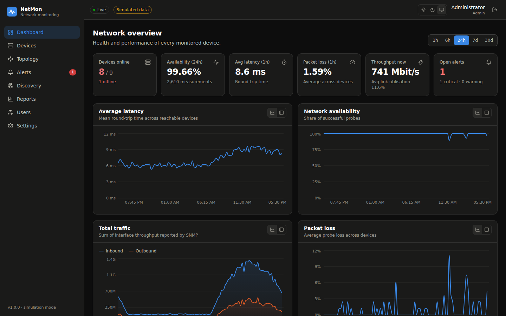
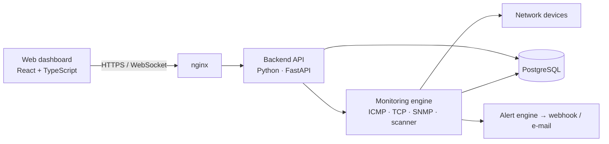
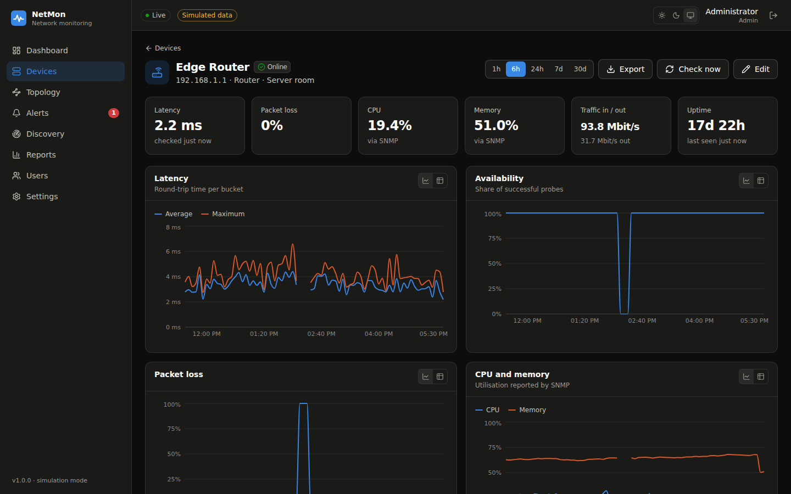
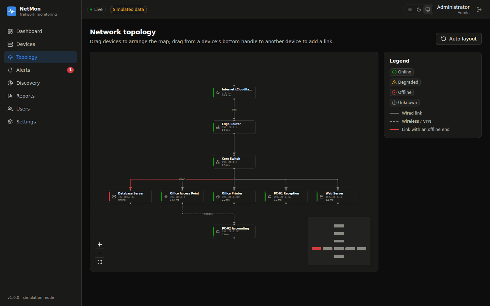
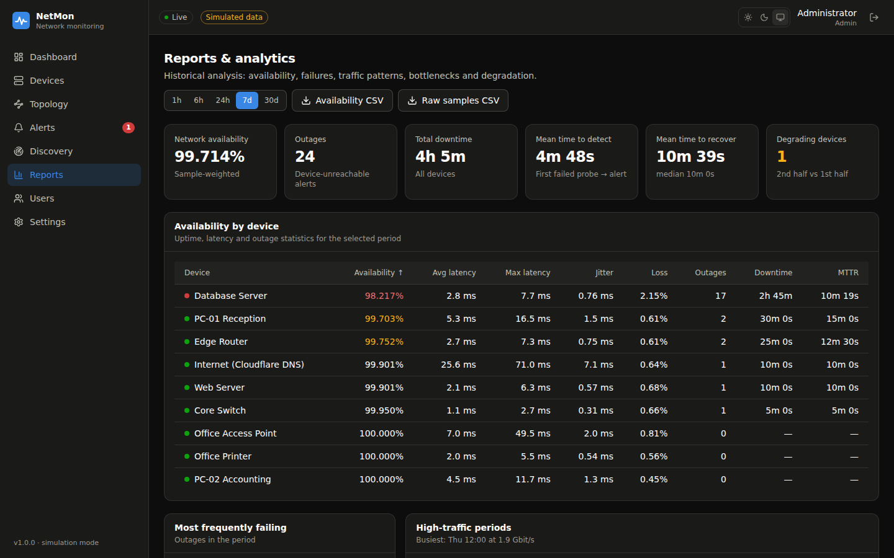
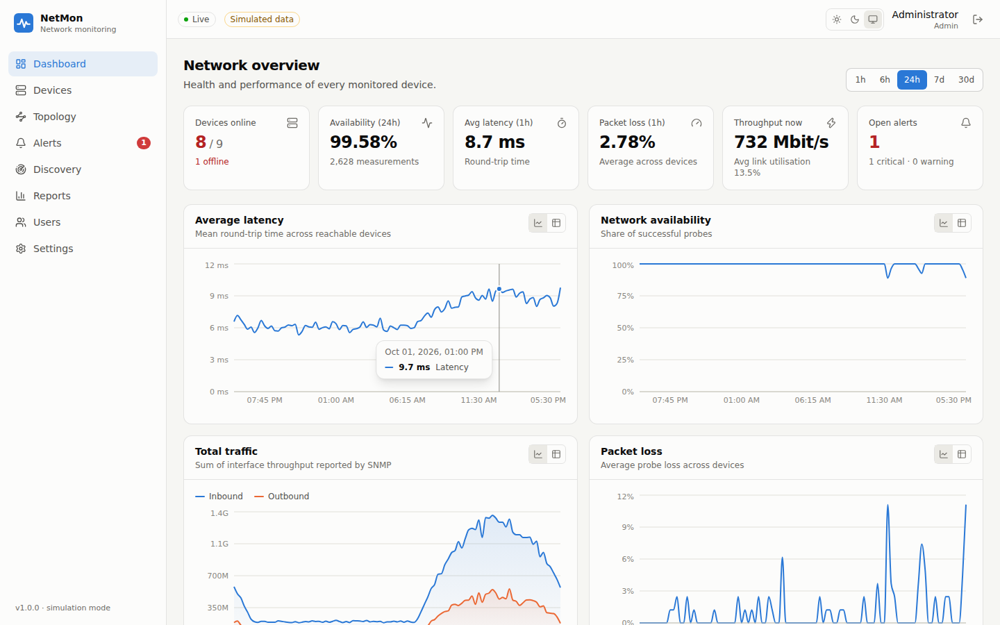

<div align="center">

# NetMon

**Network Monitoring and Management System**

Centralised, real-time monitoring of routers, switches, servers, PCs, access points and
printers - availability, latency, packet loss, CPU, memory, interfaces and bandwidth - with
alerting, topology mapping, discovery and historical analytics.

[](https://github.com/mustafaniaxi/network_monitoring_and_manegment/actions/workflows/ci.yml)


[](LICENSE)



</div>

## Features

| Module | What it does |
|---|---|
| **Authentication & authorisation** | JWT sign-in, Argon2id password hashing, roles (*admin*, *operator*, *viewer*), login throttling, session revocation on password change |
| **Device management** | Inventory of routers, switches, firewalls, servers, PCs, access points, printers; per-device poll interval, tags, SNMP v1/v2c/v3 credentials (write-only) |
| **Network discovery** | Background ping/TCP sweeps of a subnet, reverse DNS, SNMP fingerprinting with device-type suggestions, one-click bulk import |
| **Device monitoring** | ICMP echo or TCP connect probes: availability, RTT (avg/min/max), jitter, packet loss; up / degraded / down status with flap protection |
| **Performance monitoring** | SNMP: CPU, memory, uptime, IF-MIB interface status, 32/64-bit traffic counters → bit rates and bandwidth utilisation |
| **Topology visualisation** | Interactive map with automatic hierarchical layout, live link/device status, drag-to-arrange and drag-to-link |
| **Alert management** | Threshold rules with scope precedence (device > type > global), debouncing, de-duplication, auto-resolution, acknowledgement; webhook (Slack / Mattermost / Discord) and e-mail notifications |
| **Historical data** | Time-bucketed history (1 h - 30 d) in PostgreSQL, retention policy, CSV export of raw samples |
| **Reports & analytics** | Availability/SLA per device, downtime and MTTR, most frequently failing devices, high-traffic periods heatmap, bottlenecks, performance-degradation detection |
| **Research tooling** | Detection-delay statistics, monitoring-overhead accounting, experiment scripts and a containerised virtual lab |

Plus: live updates over WebSockets, light/dark themes, OpenAPI docs, Prometheus metrics,
health probes, a simulation mode for demos, and Docker images for everything.

## Quick start

**Demo in one command** (simulated office network with a week of history - nothing on your
network is probed):

```bash
git clone https://github.com/mustafaniaxi/network_monitoring_and_manegment.git netmon && cd netmon
cp .env.example .env          # set NETMON_SECRET_KEY, POSTGRES_PASSWORD, NETMON_FIRST_ADMIN_PASSWORD
docker compose -f docker-compose.yml -f docker-compose.demo.yml up -d --build
```

Open <http://localhost:8080> and sign in with `NETMON_FIRST_ADMIN_EMAIL` /
`NETMON_FIRST_ADMIN_PASSWORD` from `.env`.

**Monitor a real network**: `docker compose up -d --build`, then add devices or run a
discovery scan. **Virtual lab** with real SNMP agents: `make lab` - see
[docs/virtual-lab.md](docs/virtual-lab.md).

**Local development** (Python 3.11+ with [uv](https://docs.astral.sh/uv/), Node 22+):

```bash
make install && make dev-db
make dev-backend      # API on :8000, docs at /docs
make dev-frontend     # UI on :5173 - sign in with admin@netmon.local / ChangeMe123!
```

## Architecture



A single async Python process runs the REST API and the monitoring engine: a scheduler polls
devices concurrently, computes status and traffic rates, stores one wide sample row per poll,
evaluates alert rules in the same transaction and pushes events to connected browsers.
Details, sequence and data-model diagrams: [docs/architecture.md](docs/architecture.md).

| Layer | Technology |
|---|---|
| Backend | Python 3.12, FastAPI, SQLAlchemy 2 (async), Alembic, Pydantic v2, uvicorn |
| Networking | icmplib (ICMP), asyncio (TCP), pysnmp 7 (SNMP v1/v2c/v3) |
| Database | PostgreSQL 16 (SQLite for development and tests) |
| Frontend | React 19, TypeScript, Vite, Tailwind CSS, TanStack Query, Recharts, React Flow |
| Operations | Docker, Docker Compose, nginx, GitHub Actions, Prometheus metrics |

## Screenshots

| | |
|---|---|
|  |  |
| **Device detail** - live metrics, history, interfaces | **Topology** - automatic layout, live status |
|  |  |
| **Reports** - availability, MTTR, traffic heatmap | **Light theme** |

## Documentation

| Document | Contents |
|---|---|
| [User guide](docs/user-guide.md) | Walkthrough of every page |
| [Deployment](docs/deployment.md) | Docker Compose, TLS, manual install, backups, upgrades |
| [Configuration](docs/configuration.md) | Every `NETMON_*` environment variable |
| [Architecture](docs/architecture.md) | Components, poll pipeline, alerting, data model, scaling |
| [API guide](docs/api.md) | Authentication, endpoints, examples, WebSocket events |
| [Virtual lab](docs/virtual-lab.md) | Docker lab and VirtualBox/VMware lab setup |
| [Research methodology](docs/research.md) | Research question, metrics, experiments, analysis |
| [Development](docs/development.md) | Project layout, testing, migrations, conventions, CI |

## Research component

The system is built to answer the monograph's research question:

> *How effectively can a centralized network monitoring system detect device failures and
> network performance degradation in a small-scale network?*

NetMon records the timestamps needed to measure **detection time**, **time to recover** and
**detection accuracy**, accounts for its own **monitoring overhead** (packets, estimated
bandwidth, CPU, memory), and flags **performance degradation**. The scripts in
[`research/`](research) automate the experiments against the virtual lab and write CSV files
for analysis - see [docs/research.md](docs/research.md).

## Project status and roadmap

Version 1.0 implements the full module list of the project design (the MVP - device
registration, ping monitoring, database, dashboard, alerts - plus SNMP, topology, historical
analytics and reporting). Possible extensions:

- [ ] LLDP/CDP-based automatic topology discovery
- [ ] SNMP traps and syslog ingestion
- [ ] TimescaleDB hypertables and continuous aggregates for long retention
- [ ] Maintenance windows and alert escalation policies
- [ ] Scheduled PDF reports

## Contributing

Contributions are welcome - see [CONTRIBUTING.md](CONTRIBUTING.md). Please report security
issues privately as described in [SECURITY.md](SECURITY.md).

## License

[MIT](LICENSE)
