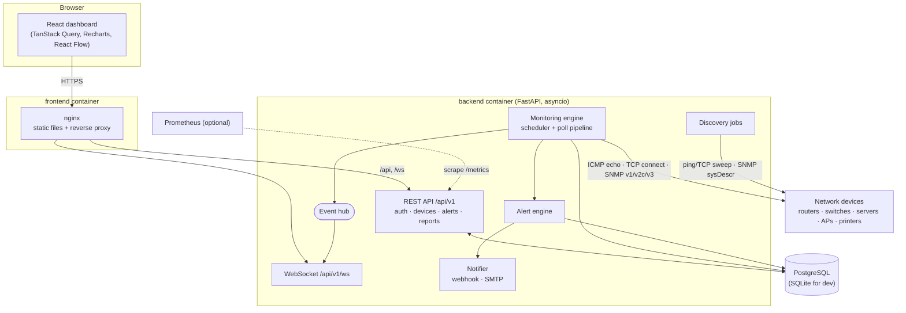
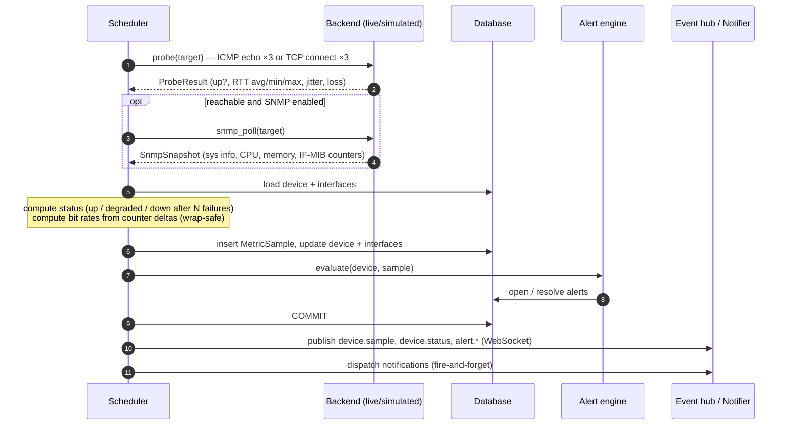
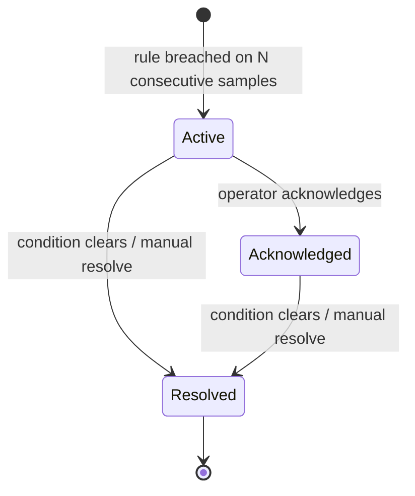
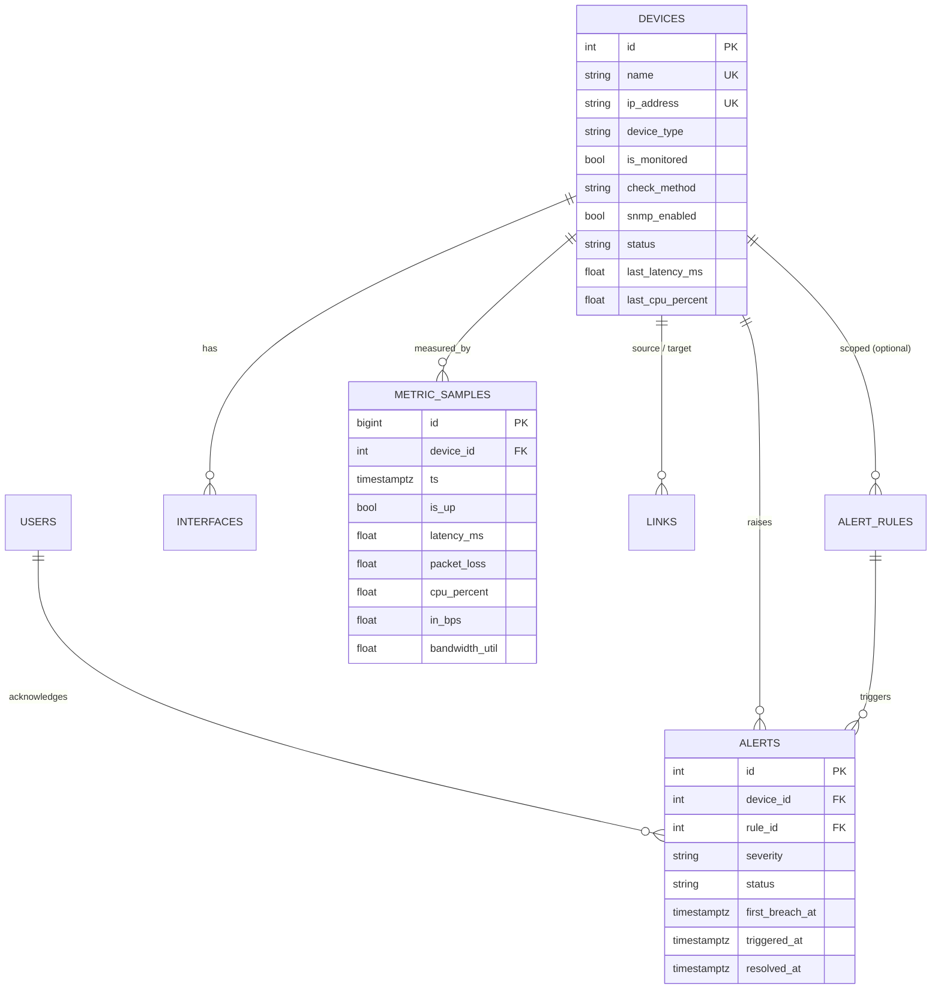

# Architecture

NetMon follows the layered design of the original project brief - *web dashboard → backend
API → ICMP/SNMP/scanner → database* - implemented as two deployable units (an API service
that also runs the monitoring engine, and a static web UI) plus a database.



## Backend layout

```
backend/netmon/
├── main.py              application factory, lifespan (engine start/stop), middleware, health
├── cli.py               `netmon` command: migrate, init, create-admin, seed-demo, serve
├── core/                settings (pydantic-settings), security (JWT, Argon2), logging
├── db/                  declarative base, portable column types, engine, Alembic migrations
├── models/              SQLAlchemy ORM models and enums
├── schemas/             Pydantic request/response models (the public API contract)
├── api/                 FastAPI dependencies (auth, RBAC) and v1 routers
└── services/
    ├── monitoring/      probes (ICMP/TCP), SNMP client, rate maths, simulation, scheduler
    ├── alerting/        rule evaluation engine, default rules, notifiers
    ├── analytics.py     time-bucketed series, dashboard KPIs, reports, research metrics
    ├── discovery.py     background subnet sweeps with SNMP fingerprinting
    ├── events.py        in-process pub/sub feeding WebSocket clients
    ├── telemetry.py     Prometheus metrics, poller statistics, process sampling
    ├── bootstrap.py     first admin, default rules, demo network
    └── demo.py          synthetic history back-fill
```

Design principles:

* **Async end to end.** FastAPI, SQLAlchemy 2 (asyncio), `icmplib`, `asyncio` TCP and pysnmp's
  asyncio API share one event loop, so hundreds of devices are polled concurrently by a single
  process without threads.
* **Probes are decoupled from persistence.** Probes receive an immutable `DeviceTarget` and
  return plain dataclasses (`ProbeResult`, `SnmpSnapshot`); only the pipeline touches the
  database. This makes the backends swappable (`LiveBackend`, `SimulatedBackend`, test fakes).
* **Portable storage.** Enums are stored as strings, timestamps through a `UTCDateTime` type
  that is timezone-aware on every backend, and 64-bit SNMP counters losslessly as text. The
  same code and migrations run on PostgreSQL and SQLite.
* **Typed contract.** Every endpoint has Pydantic request/response models; OpenAPI docs are
  generated at `/docs`. The backend passes `mypy --strict`.

## The poll pipeline

The scheduler wakes every second, dispatches every monitored device whose next due time has
passed (bounded by `NETMON_MAX_CONCURRENT_POLLS`) and spreads the first polls of new devices
over a few seconds to avoid a thundering herd.



### Status model

| Status | Meaning |
|---|---|
| `up` | Last probe answered, loss and latency below the degraded thresholds |
| `degraded` | Answered, but packet loss ≥ `NETMON_DEGRADED_PACKET_LOSS` or RTT ≥ `NETMON_DEGRADED_LATENCY_MS` |
| `down` | `NETMON_DOWN_AFTER_FAILURES` consecutive probes failed |
| `unknown` | Never polled, or monitoring disabled |

### Traffic rates

For every interface the engine stores the previous octet counters and their timestamp. The
rate is `Δoctets × 8 / Δt`; a decreasing counter is treated as a wrap at 2³² (Counter32) or
2⁶⁴ (Counter64, preferred when the agent supports IF-MIB `ifXTable`). A computed rate above
twice the link speed is discarded as a counter reset (reboot). Device throughput is the sum
over operational, non-loopback interfaces; *bandwidth utilisation* is that of the busiest
interface in its busier direction.

## Alerting



* **Rules** compare a metric (`device_down`, `latency_ms`, `packet_loss`, `cpu_percent`,
  `memory_percent`, `bandwidth_util`) against a threshold with `>`, `≥`, `<`, `≤`.
* **Scope and precedence**: a rule targets all devices, a device type, or one device. For each
  metric only the most specific matching rules apply (device > type > global), so an operator
  can relax the latency threshold for a satellite link without touching the defaults.
* **Debouncing**: `consecutive` breaches are required before an alert opens. The time of the
  first breaching sample is stored (`first_breach_at`), which makes the detection delay
  introduced by debouncing measurable.
* **De-duplication**: at most one open alert per (rule, device).
* **Noise control**: while a device is unreachable, metric rules are suspended - one
  "unreachable" alert is raised instead of a cascade of packet-loss/latency alerts.
* Example message (from the brief): `ALERT: Database Server is unreachable.`

## Data model



`metric_samples` is a *wide* table (one row per poll, one column per metric) indexed on
`(device_id, ts)`. Historical queries aggregate in SQL with an epoch bucket
(`floor(epoch(ts) / bucket) * bucket`), so the amount of data returned is bounded by
`buckets × devices` regardless of how many raw samples exist. Retention deletes raw samples
after `NETMON_METRICS_RETENTION_DAYS`.

At larger scale the same schema maps directly onto TimescaleDB (a PostgreSQL extension):
convert `metric_samples` to a hypertable and add continuous aggregates - no application change
is needed for the queries.

## Real-time updates

The engine publishes events to an in-process hub; each WebSocket client gets a bounded queue
(slow consumers drop the oldest events rather than slowing the poller). The UI throttles
cache invalidation so a burst of samples causes one refetch, and raises toasts for status
changes and new alerts.

| Event | Payload |
|---|---|
| `device.sample` | device id, status, latency, loss, CPU, memory, traffic |
| `device.status` | device id, new and previous status |
| `alert.opened` / `alert.resolved` | alert id, device, severity, message |

## Scaling notes

A single process comfortably polls hundreds of devices at a 30 s interval (each poll is a few
milliseconds of CPU; the rest is waiting on the network). Beyond that:

* run the API with monitoring disabled on extra replicas (`NETMON_MONITORING_ENABLED=false`)
  and keep exactly one engine instance;
* move the login throttle and event hub to Redis if API replicas must share them;
* use TimescaleDB for long retention.
