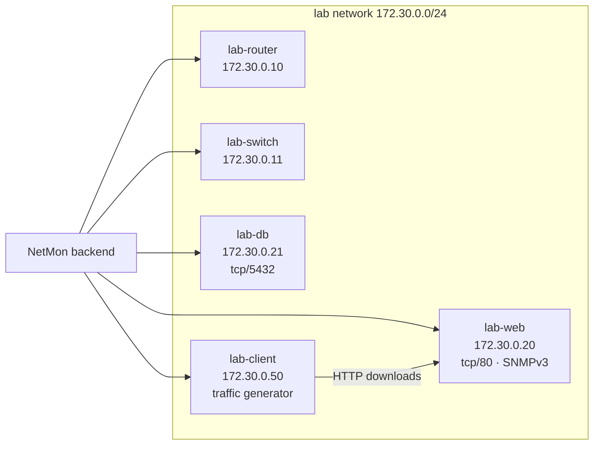

# Virtual laboratory

The project does not need physical networking equipment. A small virtual network is enough
to demonstrate every feature and to run the research experiments. Two variants are provided.

| | Docker lab | VirtualBox / VMware lab |
|---|---|---|
| Setup time | ~2 minutes | ~1 hour |
| Realism | Linux network namespaces, real ICMP/TCP/SNMP | Full operating systems, incl. Windows |
| Failure injection | `docker network disconnect` / `docker stop` | Virtual cable unplug / VM power off |
| Best for | Development, demos, repeatable experiments | Final evaluation, monograph screenshots |

## Variant A - Docker lab (one command)



Each lab "device" is a tiny Alpine container running the net-snmp agent (SNMPv2c community
`netmon-lab`; `lab-web` also accepts SNMPv3 user `netmonv3`, SHA/AES). `lab-client`
continuously downloads a file from `lab-web`, so interface traffic and bandwidth charts show
real data.

```bash
cp .env.example .env            # set the secrets
make lab                        # = docker compose -f docker-compose.yml -f lab/docker-compose.lab.yml up -d --build
python3 lab/setup_lab.py --password '<admin password>' --poll-interval 10
```

`setup_lab.py` registers the five devices (ICMP, TCP and SNMP checks, including SNMPv3) and
their topology links. Alternatively use **Discovery** in the UI: scan `172.30.0.0/24` with
community `netmon-lab` and import the hosts.

Try it:

```bash
docker network disconnect netmon_lab netmon-lab-db-1     # "unplug" the database server
# ...watch the dashboard: status → Offline, alert "ALERT: Lab DB Server is unreachable."
docker network connect --ip 172.30.0.21 netmon_lab netmon-lab-db-1
```

## Variant B - VirtualBox / VMware lab

Topology from the project brief:

```
            Monitoring Server (Ubuntu, NetMon)
                       │
        ┌──────────────┼──────────────┐
        ↓              ↓              ↓
       VM1            VM2            VM3
     Client          Server        Windows
```

1. **Network**: create a *Host-only* (or *NAT Network*) adapter, e.g. `192.168.56.0/24`, and
   attach every VM to it.
2. **Monitoring server**: Ubuntu Server 24.04, 2 vCPU / 2 GB RAM. Install Docker and start
   NetMon with `docker compose up -d` (see [deployment.md](deployment.md)).
3. **Linux VMs** (client, server):
   ```bash
   sudo apt install snmpd
   sudo sed -i 's/^agentaddress.*/agentaddress udp:161/' /etc/snmp/snmpd.conf
   # read-only community with the full MIB view (IF-MIB, HOST-RESOURCES, UCD memory)
   echo 'rocommunity netmon-lab 192.168.56.0/24' | sudo tee -a /etc/snmp/snmpd.conf
   sudo systemctl restart snmpd
   ```
4. **Windows VM**: *Settings → Apps → Optional features → Add "Simple Network Management
   Protocol (SNMP)"*, then in *services.msc → SNMP Service → Security* add community
   `netmon-lab` (READ ONLY) and accept packets from the monitoring server. Allow *File and
   Printer Sharing (Echo Request - ICMPv4-In)* in the firewall so ping works.
5. **Router/switch (optional)**: GNS3 or EVE-NG images (Cisco IOSv, MikroTik CHR, VyOS) can be
   bridged into the same network; enable SNMP with `snmp-server community netmon-lab RO`.
6. In NetMon, run **Discovery** on `192.168.56.0/24` with community `netmon-lab`, import the
   hosts, and draw the links on the **Topology** page.

Failure injection for experiments:

```bash
VBoxManage controlvm "VM2-Server" setlinkstate1 off   # unplug the virtual cable
VBoxManage controlvm "VM2-Server" setlinkstate1 on
# VMware Workstation: vmrun disconnectNamedDevice / connectNamedDevice <vmx> ethernet0
```

These commands plug straight into the research scripts via
`--method command --fail-cmd ... --restore-cmd ...` (see [research.md](research.md)).
